# Plano Mestre de Evolução Agêntica, Skills & Harness — Uzina Studio (Fase 3 & 4 · Slices 26 a 34)

**Base:** `main` (pós-Slice 25, Plano Mestre P0–P3 100% entregue) · **Regra de Execução:** estritamente 1 Vertical Slice por vez em sua branch dedicada, seguindo `Plan Gate (EGM)` → `Contract-First (@uzina/contracts)` → `TDD Estrito (RED → GREEN → REFACTOR)` → `PGlite em memória / MSW` → `pnpm verify` + `test-critic` + `appsec-auditor` + `factory-verifier`.

---

## 1. Propósito, Fundamentos da Indústria & Conformidade Legal

Este plano consolida todas as melhorias identificadas nas **Rodadas 1 e 2** de diagnóstico arquitetural do Uzina Studio, cruzando o código real dos pacotes `@uzina/*` com as práticas de fronteira da indústria (2025–2026) e os padrões abertos da comunidade de *Agent Skills*.

### 1.1 Princípios de Engenharia Integrados
1. **Harness Engineering (`Agent = Model + Harness` — OpenAI):** o modelo de LLM raramente é o gargalo; o ganho real vem do ambiente determinístico ao redor (worktrees, contenção de arquivos, compilador/testes allowlisted, sensores arquiteturais e gestão de entropia).
2. **Context Engineering & Fresh-Context Evaluator (Anthropic):** combate ativo ao *context rot* e à *context anxiety* via carregamento progressivo (*Progressive Disclosure*), compressão observacional (`ObservationalMemory`), memória tática estruturada (`WorkingMemory`) e avaliador independente em contexto limpo com postura *Default-FAIL*.
3. **Blueprints Híbridos (Stripe Minions):** intercalar etapas determinísticas previsíveis (worktrees, parsers, scanners, locks, `tsc`, testes) com loops agênticos curtos e *circuit breakers* rígidos (máximo 2–3 tentativas antes de escalar).
4. **Multi-Agent Missions & Model Tiering (Factory.ai / `wshobson/agents`):** separação clara entre Orquestrador, Workers e Validadores, com roteamento econômico por papel (`Tier 3 Pro` em Arquitetura/Verify vs. `Tier 2 Flash` em Descoberta/Triagem vs. `Tier 1 Local` em QMD/AST).
5. **Spec-Driven Development Dual (Greenfield vs. Brownfield):** **`github/spec-kit`** (Constituição → Specify → Plan → Tasks) para sistemas novos e **`Fission-AI/OpenSpec`** (deltas `ADDED` / `MODIFIED` / `REMOVED` + `sync/archive` sobre especificação viva) para evolução de sistemas existentes.
6. **Disciplina Anti-Atalho (`obra/superpowers`):** **Iron Laws** binárias no topo de cada skill, **Tabelas Anti-Racionalização (*Red Flags*)** anulando desculpas comuns do LLM, **Depuração Científica** antes de patches e **Two-Stage Review** (*Spec Compliance* antes de *Code Quality*).
7. **Invariante Upstream & Story Sharding (`BMAD-METHOD`):** handoffs entre fases ocorrem exclusivamente por **artefatos contratuais imutáveis** (nunca por chat bruto), impedindo que agentes *downstream* inventem escopo *upstream*.
8. **Design & AppSec de Fronteira:** pipeline visual **Lead → Reference → Critique** (inspirado em `frontend-design` + `ui-ux-pro-max` + `impeccable`) para eliminar *aesthetic averaging* e *AI slop*; revisão diferencial de segurança, *insecure defaults*, *sharp edges* e *refuting verifiers* (inspirado em `trailofbits/skills`).

### 1.2 Conformidade Estrita de Licenciamento (Apache 2.0 & Open-Source Seguro)
- **Zero módulos `ee/` do Mastra:** uso exclusivo de primitivas Apache 2.0 confirmadas na versão instalada (`@mastra/core@1.85.0` e `@mastra/memory@1.41.2`): `SkillsProcessor`, `SkillSearchProcessor`, `WorkingMemory`, `SemanticRecall`, `ModelSelectionProcessor`, `PromptInjectionDetector`, `CostGuardProcessor`, `TokenCostControl`, `StructuredOutputProcessor`, `AgentsMDInjector`, `ToolSearchProcessor`, `TokenLimiterProcessor` e `ObservationalMemory`. `node scripts/check-no-ee.mjs` deve retornar `0` em todos os slices.
- **Higiene de Licenças nas Skills:** conceitos vindos de repositórios `MIT`/`Apache-2.0` (`obra/superpowers`, `BMAD-METHOD`, `github/spec-kit`, `Fission-AI/OpenSpec`, `vercel-labs/agent-skills`, `supabase/agent-skills`, `getsentry/skills`) e conceitos de repositórios `CC-BY-SA-4.0` (`trailofbits/skills`) ou licenças específicas (`anthropics/skills`) serão **redigidos de forma 100% autoral** em `packages/skills/`, sem cópia literal de textos ou arquivos de terceiros.

---

## 2. Mapa Visual da Trilha de Execução (Slices 26 → 34)

```mermaid
flowchart LR
    S26["Slice 26: Controller Dinamico, SkillsLoader v2 e Memoria/Guardrails"] --> S27["Slice 27: Biblioteca de 16 Skills v2 (Iron Laws e Anti-Conflito)"]
    S27 --> S28["Slice 28: Desbloqueio de Tools por Papel (AST, UX, AppSec, FinOps)"]
    S28 --> S29["Slice 29: Handoffs Imutaveis (Discovery, Arquiteto, UX 3 Estagios)"]
    S29 --> S30["Slice 30: Builder Harness (Test Lock, Micro-Loop e 3 Strikes)"]
    S30 --> S31["Slice 31: Two-Stage Verifier, PR Risk Briefing e Retro QMD"]
    S31 --> S32["Slice 32: CI Evals de Trajetoria e Painel de Efetividade"]
    S32 --> S33["Slice 33 (Onda 2): AppSec v2 (DAST, Reachability, SBOM, Prompt-Guard)"]
    S33 --> S34["Slice 34 (Onda 2): QA Visual A11y, Mutation/PBT, Skills Lock e Entropia"]
```

---

## 3. Inventário Auditado de Bugs, Gargalos e Lacunas no Código Atual

Todos os itens abaixo foram verificados diretamente no código-fonte após o encerramento do Slice 25:

| ID | Localização Exata no Código | Diagnóstico Real (Bug / Gargalo / Lacuna) | Slice Destino |
| :--- | :--- | :--- | :---: |
| **BUG-01** | [controller.ts](file:///c:/Users/gamam/OneDrive/Documentos/_Fabrica_softwares/packages/mastra-runtime/src/controller.ts#L226-L237) | `backingAgent` do `UzinaAgentController` é instanciado com modelo hardcoded `"openai/gpt-4o-mini"`, ignorando `createTenantModelResolver` e o roteamento por modo (`discovery`, `architect`, `visual`, `build`, `review`). | **Slice 26** |
| **BUG-02 / GAP-01** | [engineering-agents.ts](file:///c:/Users/gamam/OneDrive/Documentos/_Fabrica_softwares/packages/mastra-runtime/src/agents/engineering-agents.ts#L14-L40) | `ROLE_INSTRUCTIONS` possui apenas 2–3 linhas genéricas por agente e não integra `SkillsProcessor` / `SkillSearchProcessor` de `@mastra/core/processors` (hoje skills entram só no executor de código em `workspace-adapter.ts`). | **Slice 26** |
| **GAP-02** | [packages/skills](file:///c:/Users/gamam/OneDrive/Documentos/_Fabrica_softwares/packages/skills/discovery-interview/SKILL.md) & [skills-loader.ts](file:///c:/Users/gamam/OneDrive/Documentos/_Fabrica_softwares/packages/core/src/skills-loader.ts#L32-L219) | As 8 skills têm apenas 12–19 linhas, sem *Iron Laws*, *Anti-Rationalization Tables*, `references/`, `templates/` nem `scripts/`. `skills-loader.ts` ainda não carrega subpastas sob demanda (*Progressive Disclosure* `agentskills.io`) nem valida limites (`name <= 64`, `description <= 1024`, corpo `< 500` linhas). | **Slices 26–27** |
| **GAP-03** | [graph.ts](file:///c:/Users/gamam/OneDrive/Documentos/_Fabrica_softwares/packages/codebase-intel/src/graph.ts#L36-L246) vs. [workspace-tools.ts](file:///c:/Users/gamam/OneDrive/Documentos/_Fabrica_softwares/packages/mastra-runtime/src/tools/workspace-tools.ts#L191-L296) | `@uzina/codebase-intel` já possui `querySymbolGraphInMemory`, `computeChangeImpactInMemory` e `readSymbolSliceFromWorkspace`, mas os agentes da agência só recebem `inspect_codebase_skeleton` (30 arquivos) e `query_codebase_symbols` (`ILIKE %query%`). | **Slice 28** |
| **GAP-04** | [workspace-tools.ts](file:///c:/Users/gamam/OneDrive/Documentos/_Fabrica_softwares/packages/mastra-runtime/src/tools/workspace-tools.ts#L379-L411) | `ux_designer` não possui tool para ler `.uzina/DESIGN.md` ou versões `v1..vN` de `designPrototypes`. `qa_appsec` não possui nenhuma tool para ler `securityScans`, `securityFindings` (SARIF), `EvidencePack`, `diffSummary.fileDiffs` ou rodar `auditTestDirectory`. `Executive Copilot` não lê métricas de FinOps/risco. | **Slice 28** |
| **GAP-05** | [agency.ts](file:///c:/Users/gamam/OneDrive/Documentos/_Fabrica_softwares/packages/mastra-runtime/src/agency.ts#L205-L315) | `decideOptimalAiStrategy` e `inferDomainVisualBlueprint` decidem arquitetura e blueprint visual por regexes fixas em vez de Structured Output Zod do Arquiteto/UX com contexto real (mantendo regex apenas como fallback offline). | **Slice 29** |
| **GAP-06** | [workspace-adapter.ts](file:///c:/Users/gamam/OneDrive/Documentos/_Fabrica_softwares/packages/mastra-runtime/src/workspace-adapter.ts#L409-L569) | No `stageBuild`, `MastraWorkspaceExecutorAdapter` não bloqueia edição em `contractTestFiles` (risco de *reward hacking*) e desabilita sandbox sem oferecer micro-loop allowlisted (`run_scoped_typecheck` / `run_scoped_unit_test`). | **Slice 30** |
| **GAP-07** | [deliverable-lifecycle.ts](file:///c:/Users/gamam/OneDrive/Documentos/_Fabrica_softwares/packages/mastra-runtime/src/workflows/deliverable-lifecycle.ts#L4031-L4120) | `VerifierVerdictOutputSchema` é genérico sem matriz obrigatória Requisito ↔ Teste ↔ Diff (*Two-Stage Review*), sem *Refuting Verifier* e sem destilação automática de falhas/rejeições HITL para QMD. | **Slice 31** |
| **GAP-08** | [engine.ts](file:///c:/Users/gamam/OneDrive/Documentos/_Fabrica_softwares/packages/security-engine/src/engine.ts#L69-L98) | `targetType === "staging_url"` valida apenas anti-SSRF (`dast_url_guard`) e devolve `findings: []`; falta DAST passivo/Nuclei, SCA *Reachability Analysis*, SBOM CycloneDX e scanner contra *indirect prompt injection* em CI/Brownfield. | **Slice 33** |
| **GAP-09** | [memory-runtime.ts](file:///c:/Users/gamam/OneDrive/Documentos/_Fabrica_softwares/packages/mastra-runtime/src/memory-runtime.ts#L110-L231) & [processors.ts](file:///c:/Users/gamam/OneDrive/Documentos/_Fabrica_softwares/packages/mastra-runtime/src/processors.ts#L286-L336) | Falta `WorkingMemory` tipada com schema Zod, `SemanticRecall` cross-thread isolado por `resourceId` e `PromptInjectionDetector` para *untrusted checkouts* / saídas externas. | **Slice 26** |
| **GAP-10** | [deliverable-lifecycle.ts](file:///c:/Users/gamam/OneDrive/Documentos/_Fabrica_softwares/packages/mastra-runtime/src/workflows/deliverable-lifecycle.ts#L3476-L4427) | `stageVerify` ainda não executa QA visual/a11y automatizado (`Playwright + axe-core`) para `hasUi: true`, nem *Mutation/Property-Based Testing*, nem Evals de trajetória em CI. | **Slices 32 & 34** |

---

## 4. Visão Geral dos 9 Vertical Slices (Onda 1 + Onda 2)

| Onda | Slice | Branch | Foco Principal |
| :---: | :---: | :--- | :--- |
| **1** | **Slice 26** | `fix/slice-26-controller-model-resolver-skills-loader-v2` | Correção do `AgentController` dinâmico, `skills-loader` v2 (`agentskills.io`), Playbooks Sênior + `SkillsProcessor`, `WorkingMemory` (Zod), `SemanticRecall` e `PromptInjectionDetector`. |
| **1** | **Slice 27** | `feat/slice-27-skills-library-v2-iron-laws-16-skills` | Upgrade das 8 skills atuais + criação de 8 novas skills autorais (16 total) com *Iron Laws*, *Anti-Rationalization*, `references/`, `templates/`, `scripts/` e regras *Lead → Reference → Critique*. |
| **1** | **Slice 28** | `feat/slice-28-role-workspace-tools-codebase-design-appsec` | 14 novas tools tipadas com Zod e RBAC/multi-tenant expondo grafo AST, impacto de mudança, leitura cirúrgica de símbolos, conflitos de requisitos, FinOps, `.uzina/DESIGN.md`, protótipos, SARIF, `EvidencePack` e worktrees. |
| **1** | **Slice 29** | `feat/slice-29-discovery-architect-ux-structured-handoffs` | Handoffs imutáveis e raciocínio estruturado nas Fases 1, 2 e 2.5 (`ShapeSpec`, *Ambiguity Gate*, `decideOptimalAiStrategy` LLM + fallback, ADR + STRIDE/FMEA + *Story Sharding*, *OpenSpec* deltas, UX 3 estágios + Manifesto de Componentes). |
| **1** | **Slice 30** | `feat/slice-30-builder-harness-test-lock-micro-loop-debug` | Harness de execução de código: **Test Lock** (anti-*reward hacking*), micro-loop allowlisted (`run_scoped_typecheck`, `run_scoped_unit_test`, `validate_migration_safety`), *3-Strikes Scientific Debugging* no `StuckDetector` e passada de simplificação. |
| **1** | **Slice 31** | `feat/slice-31-two-stage-verifier-adversarial-qa-retro` | *Two-Stage Verifier* em contexto limpo (Matriz Requisito↔Teste↔Diff + QA Adversarial/AppSec + *Refuting Verifier*), *Risk-Ranked Decision Briefing* + *Confidence Score*, destilação automática de retrospectiva para QMD e *OpenSpec sync/archive*. |
| **1** | **Slice 32** | `feat/slice-32-agentic-ci-evals-trajectory-gates` | Suíte determinística de Evals de Trajetória agêntica no CI (`pnpm verify`), métricas de efetividade (*First-Pass Verify Rate*, aderência a skills, retrabalho) e telemetria no painel do cockpit. |
| **2** | **Slice 33** | `feat/slice-33-appsec-v2-dast-reachability-sbom-agentic-guard` | AppSec v2 em `@uzina/security-engine`: DAST passivo real + adaptador Nuclei, *Reachability Analysis* (Trivy + AST) + EPSS/KEV, geração de SBOM CycloneDX e scanner nativo de *Prompt Injection* em CI/Brownfield. |
| **2** | **Slice 34** | `feat/slice-34-visual-a11y-mutation-pbt-and-skills-registry` | QA Visual & A11y (`Playwright + axe-core`) em `stageVerify`, suporte a *Property-Based Testing* (`fast-check`) e *Mutation Testing* (Stryker), `skills-lock.json` (com SHA-256 e UI) e rotina de *Entropy Management*. |

---

## 5. Especificação Detalhada por Slice

### Slice 26 — `fix/slice-26-controller-model-resolver-skills-loader-v2`
**Objetivo & Bugs/Lacunas Resolvidos:** Corrige **BUG-01**, **BUG-02/GAP-01**, **GAP-02 (loader)** e **GAP-09**. Garante que nenhum agente converse com modelo hardcoded, que todos os 6 especialistas usem playbooks sênior com carregamento progressivo de skills e que a memória/segurança de contexto opere em nível de produção.

* **Contratos Zod & Schema DB (`@uzina/contracts`, `@uzina/db`):**
  * Estender `SkillDefinitionSchema` em `packages/contracts` com:
    * `version`, `license`, `phase` (`discovery | architecture | visual | build | verify | release`), `roleCategory` (`lead | reference | critique`), `ironLaw` (string opcional), `references` (lista de caminhos relativos), `templates` (lista), `scripts` (lista) e `budgets` (`nameLength`, `descriptionLength`, `bodyLines`).
  * Criar `AgencyWorkingMemorySchema` (para `@mastra/memory` `WorkingMemory`):
    * `{ activeDeliverableId, activePhase, strategyDecision, lockedDecisions[], openRisks[], currentHypothesis, lastTestFailureSummary }`.
  * Sem alteração de schema SQL necessária neste slice (usa tabelas já existentes de `@mastra/pg` / `@mastra/libsql` para `WorkingMemory` e vetores/recall).
* **Mudanças por Pacote/Arquivo:**
  1. `packages/core/src/skills-loader.ts`:
     * Suportar estrutura `packages/skills/<nome>/{SKILL.md,references/*,templates/*,scripts/*}` mantendo retrocompatibilidade com skills simples.
     * Validar limites *Progressive Disclosure* (`name <= 64`, `description <= 1024`, corpo `< 500` linhas — emitindo erro ou warning estrito no loader).
     * Expor `loadSkillResource(skillName, relativeResourcePath, options)` com contenção de path traversal (`assertPathInsideWorkspace`) para leitura sob demanda de `references/`, `templates/` e `scripts/`.
  2. `packages/mastra-runtime/src/controller.ts` (#L183-L320):
     * Remover `"openai/gpt-4o-mini"` hardcoded de `backingAgent`.
     * Injetar `model` dinâmico via função `{ requestContext } => resolver.resolveForRole(orgId, mapControllerModeToAgencyRole(mode))` combinada com `ModelSelectionProcessor` / `processInputStep` para alternar o modelo e as instruções específicas ao trocar entre `discovery`, `architect`, `visual`, `build` e `review` (mantendo fallback `modelOverride` para testes).
  3. `packages/mastra-runtime/src/agents/engineering-agents.ts`:
     * Substituir `ROLE_INSTRUCTIONS` de 2 linhas por **Playbooks Sênior Estruturados** (identidade, protocolo Step 0, restrições negativas explícitas, protocolo de handoff e postura anti-alucinação).
     * Integrar `SkillsProcessor` e `SkillSearchProcessor` de `@mastra/core/processors` nos 6 especialistas e no `backingAgent` (carregando apenas metadados no startup e corpo `SKILL.md` / `references/` sob demanda).
  4. `packages/mastra-runtime/src/memory-runtime.ts`:
     * Habilitar `workingMemory: { enabled: true, schema: AgencyWorkingMemorySchema }` com escopo isolado por `resourceId`.
     * Habilitar `semanticRecall` (`scope: "resource"`, `topK: 4`, `messageRange: 2`) usando o `EmbeddingProvider` local já configurado no Uzina Studio (Slice 7/11), respeitando isolamento multi-tenant (`uzina:agency:org:<orgId>:project:<projId>`).
  5. `packages/mastra-runtime/src/processors.ts`:
     * Integrar `PromptInjectionDetector` (estratégia `"rewrite"` para dados/checkouts externos ou `"block"` em payload crítico) quando `untrustedCheckout: true` ou ao processar conteúdo vindo de repositórios externos/scanners.
     * Integrar `TokenCostControl` / `CostGuardProcessor` alinhado ao `budgetCapUsd` da organização/projeto.
* **Plano TDD (RED → GREEN):**
  * `packages/core/tests/skills-loader-v2.test.ts`: testar descoberta de `references/`/`templates/`, rejeição de path traversal em `loadSkillResource`, e validação de orçamento (`name > 64` falha).
  * `packages/mastra-runtime/tests/slice26-controller-memory-skills.test.ts`: testar que `AgentController` resolve modelos distintos para `architect` vs `product_discovery` do tenant (nunca `"openai/gpt-4o-mini"` quando há provedor configurado), que `WorkingMemory` preserva estado entre turnos de agentes diferentes na mesma thread, que `SemanticRecall` não vaza dados entre `organizationId` distintos, e que `PromptInjectionDetector` neutraliza tentativa de injeção em checkout não confiável.
* **Critérios de Pronto (DoD) & Verificação:**
  * `node scripts/check-no-ee.mjs` = `0`; `pnpm --filter @uzina/core test`; `pnpm --filter @uzina/mastra-runtime test`; `pnpm verify`.

---

### Slice 27 — `feat/slice-27-skills-library-v2-iron-laws-16-skills`
**Objetivo & Lacunas Resolvidas:** Resolve **GAP-02** elevando as 8 skills existentes ao padrão `agentskills.io` + `superpowers` e criando 8 novas skills autorais cobrindo todas as lacunas reais do SDLC (total: **16 skills**).

* **Padrão Obrigatório de Toda Skill v2 (`packages/skills/<slug>/SKILL.md`):**
  * Frontmatter YAML: `name`, `description` (com gatilho *"Use quando..."*), `applies_to_roles`, `phase`, `role_category` (`lead | reference | critique`), `license: Apache-2.0`.
  * Corpo `< 500` linhas estruturado em:
    1. **Iron Law (Lei de Ferro)** — regra binária inegociável;
    2. **Entry Gate & Exit Artifact** — o que precisa existir para começar e o artefato exato entregue;
    3. **Protocolo Passo a Passo** — incluindo Step 0 de leitura silenciosa;
    4. **Tabela Anti-Racionalização (*Red Flags*)** — desculpa comum do LLM vs. ação corretiva obrigatória;
    5. **Ponteiros Progressivos** — quando abrir `references/*.md`, `templates/*.md` ou rodar `scripts/*.mjs`.
* **Upgrade das 8 Skills Existentes:**
  1. `discovery-interview` (*Lead* · Fase 1): incorpora refinamento socrático, *Appetite* + *Non-Goals* (Shape Up) e pré-leitura Brownfield; adiciona `templates/shape-spec-template.md`.
  2. `brownfield-archaeology` (*Lead* · Fase 1B/2): incorpora mapeamento função-a-função pré-mudança, identificação de *seams* para *Strangler Fig* e `references/maturity-scorecard-rubric.md`.
  3. `architecture-blueprint` (*Lead* · Fase 2): incorpora ADR obrigatório, *Fitness Functions*, *File Ownership* + análise de contenção no `SymbolLockManager` e `templates/adr-rfc-template.md`.
  4. `visual-design-md` (*Lead* · Fase 2.5): incorpora direção estética intencional anti-"AI slop", W3C Design Tokens, 5 estados de dados e `references/tokens-wcag-checklist.md`.
  5. `contract-first-msw` (*Reference* · Fase 3A): incorpora *Story Sharding*, derivação de handlers MSW para todos os códigos HTTP (`200/400/401/403/422/500`) e `templates/contract-drift-test.md`.
  6. `test-quality-engineering` (*Reference/Critique* · Fase 3A/4): incorpora Iron Law do TDD Red-Green-Refactor, Análise de Valor Limite (BVA), Partição de Equivalência e tabela anti-racionalização contra *test theater*.
  7. `secure-code-audit` (*Critique* · Fase 4): incorpora triagem em 3 vereditos + *Refuting Verifier* (tentar refutar o achado antes de confirmar) + PoV obrigatório e `references/sarif-triage-guide.md`.
  8. `safe-db-migrations` (*Reference* · Fase 3B/4): incorpora padrões Postgres/Drizzle (Expand-Migrate-Contract, `CREATE INDEX CONCURRENTLY`, locks de DDL, RLS multi-tenant, paginação por cursor) e `scripts/check-migration-ddl.mjs`.
* **Criação das 8 Novas Skills Autorais:**
  9. `domain-event-storming-bdd` (*Reference* · Fase 1): Eventos de Domínio, Atores, Políticas e geração de critérios `Dado/Quando/Então` + matriz RBAC/LGPD.
  10. `openspec-brownfield-delta` (*Lead* · Fase 1/2): modelo de especificação por deltas `ADDED / MODIFIED / REMOVED` sobre docs vivos sem reescrever o sistema inteiro.
  11. `threat-modeling-stride-fmea` (*Reference* · Fase 2): matriz STRIDE nas fronteiras de confiança (multi-tenancy, cofre, uploads, LLM/MCP) + FMEA (*Failure Mode & Effects Analysis*).
  12. `ui-design-critique-a11y` (*Critique* · Fase 2.5/4): auditoria em passo separado de hierarquia, ritmo espacial 4/8px, WCAG 2.1 AA, teclado, *touch targets* $\ge 44\text{px}$ em `390px` e zero vazamento visual de RBAC.
  13. `systematic-debugging-3-strikes` (*Lead* · Fase 3B): depuração científica em 4 fases (reproduzir → isolar causa-raiz → hipótese única → verificar), regra estrita de escalação após 2ª–3ª falha e poda pré-review (*code simplifier*).
  14. `property-based-and-mutation-qa` (*Reference/Critique* · Fase 3A/4): invariantes com `fast-check` para regras puras/parsers e protocolo de avaliação por mutantes mentais/Stryker.
  15. `differential-appsec-sharp-edges` (*Critique* · Fase 4): análise focada no `git diff`, detecção de *fail-open defaults*, APIs armadilha (*sharp edges*), busca de variantes irmãs (*variant analysis*) e riscos em CI/workflows agênticos.
  16. `release-briefing-and-retro` (*Lead* · Fases 5/6): *Risk-Ranked PR Briefing*, *Confidence Score*, plano de rollout/rollback e destilação pós-mortem de convenções para QMD.
* **Regra de Orquestração Anti-Conflito (`Lead → Reference → Critique`):**
  * Adicionar em `packages/core/src/skills-loader.ts` função `selectNonConflictingSkillsForStage(stage, skills)` que garante no máximo **1 skill `lead`** ativa por turno, acompanhada apenas das skills `reference` pertinentes ao domínio e executando skills `critique` somente no passo avaliador.
* **Plano TDD (RED → GREEN):**
  * `packages/core/tests/skills-catalog-integrity.test.ts`: validar via `test.each` todas as 16 pastas em `packages/skills/` (frontmatter válido, `name <= 64`, `description <= 1024`, `< 500` linhas, presença de seções obrigatórias `Iron Law` e `Red Flags` / anti-racionalização, recursos referenciados existentes em disco, e `selectNonConflictingSkillsForStage` garantindo unicidade de `lead`).
* **Critérios de Pronto (DoD) & Verificação:**
  * Todas as 16 skills validadas pelo teste de integridade + `pnpm verify`.

---

### Slice 28 — `feat/slice-28-role-workspace-tools-codebase-design-appsec`
**Objetivo & Lacunas Resolvidas:** Resolve **GAP-03** e **GAP-04**, dando a todos os 6 especialistas da agência + Co-piloto Executivo acesso seguro, auditado e escopado por `organizationId` e `OrgRole` às capacidades já existentes no monorepo.

* **Contratos Zod (`@uzina/contracts`):**
  * Schemas de input/output para todas as novas tools (garantindo redação de segredos e paginação/limites de bytes para não estourar contexto).
* **Novas Tools por Papel em `packages/mastra-runtime/src/tools/workspace-tools.ts` e `executive-copilot.ts`:**
  1. **Inteligência de Código (`software_architect`, `tech_lead`, `qa_appsec`):**
     * `trace_symbol_call_graph`: consulta `querySymbolGraphInMemory` (`packages/codebase-intel/src/graph.ts`) com `depth` (`1..3`) e `relation`.
     * `analyze_change_impact`: consulta `computeChangeImpactInMemory` retornando símbolos e rotas afetadas por uma lista de arquivos.
     * `read_symbol_source_slice`: invoca `readSymbolSliceFromWorkspace` com contenção de workspace e redação de segredos, retornando apenas o recorte da função/tipo + métrica `savingsPercent`.
     * `check_dependency_boundaries`: valida se imports propostos violam as fronteiras do monorepo (`@uzina/contracts` → `@uzina/db`/`core` → engines → `mastra-runtime`).
  2. **Produto & Executivo (`product_discovery`, `Executive Copilot`):**
     * `check_requirement_conflicts`: cruza busca QMD (`domain_rule`, `architecture`) + deliverables ativos para apontar conflitos/sobreposições antes de fechar PRD.
     * `read_finops_and_risk_digest` (para `Executive Copilot` e `orchestrator`): retorna consumo USD/tokens, `budgetCapUsd`, taxa de retrabalho (`verifyAttempts`) e contagem de achados críticos abertos por projeto.
  3. **Design & UX (`ux_designer`):**
     * `read_design_system_contract`: lê `.uzina/DESIGN.md` / `designAssets` aprovados e lista componentes disponíveis em `packages/ui` (`data-slot`).
     * `inspect_prototype_version`: lê metadados, seções DOM e resumo sanitizado das versões `v1..vN` de `designPrototypes`.
     * `validate_color_contrast_and_tokens`: calcula razão de contraste WCAG (4.5:1 / 3:1) para pares de tokens hex/OKLCH e aponta tokens inválidos ou cores hardcoded.
  4. **QA & AppSec (`qa_appsec`):**
     * `read_security_scan_findings`: consulta `securityScans` + `securityFindings` filtrando por severidade, scanner e veredito (`confirmed | false_positive | unknown`).
     * `read_deliverable_evidence_and_diff`: lê `EvidencePack`, `diffSummary.fileDiffs` e `testCommandOutput` redigidos de um entregável.
     * `run_test_anti_pattern_audit`: executa `auditTestDirectory` de `@uzina/core` no workspace do projeto/worktree (somente leitura) e retorna violações por arquivo/linha.
  5. **Coordenação (`orchestrator`):**
     * `inspect_worktrees_and_locks`: lê `listProjectWorktrees` e locks ativos do `SymbolLockManager` para diagnosticar filas (`queued_waiting_lock`) ou worktrees órfãos.
     * `distill_retrospective_memory`: persiste aprendizados destilados em QMD (`WRITE_ROLES` apenas).
* **Atualização de `controller.ts` (`CONTROLLER_MODE_TOOLS`):**
  * Mapear exatamente as novas tools nos 5 modos (`discovery`, `architect`, `visual`, `build`, `review`) respeitando princípio de menor privilégio (ex.: `review` é estritamente read-only).
  * Garantir `ToolSearchProcessor` ativo quando um agente tiver $\ge 8$ tools para não inflar o system prompt.
* **Plano TDD (RED → GREEN):**
  * `packages/mastra-runtime/tests/slice28-workspace-tools-rbac.test.ts`:
    * Testar isolamento multi-tenant (tentar consultar `projectId` de outra organização falha em todas as novas tools);
    * Testar RBAC (perfil `auditor` bloqueado em `distill_retrospective_memory`, liberado nas tools de leitura);
    * Testar cálculo matemático de contraste WCAG (`#ffffff` sobre `#f5f5f4` reprova 4.5:1; `#1c1917` sobre `#fafaf9` aprova);
    * Testar `read_symbol_source_slice` bloqueando `.env` e `.master-key`.
* **Critérios de Pronto (DoD) & Verificação:**
  * `pnpm --filter @uzina/mastra-runtime test` + `appsec-auditor` sobre as novas tools + `pnpm verify`.

---

### Slice 29 — `feat/slice-29-discovery-architect-ux-structured-handoffs`
**Objetivo & Lacunas Resolvidas:** Resolve **GAP-05** e implanta o **Invariante Upstream → Downstream** com artefatos imutáveis nas Fases 1, 2 e 2.5.

* **Contratos Zod (`@uzina/contracts`):**
  * `ShapeSpecSchema`: estende `DiscoverySummarySchema` com `appetite` (`small_1_slice | medium_2_3_slices | large_epic`), `nonGoals: string[]` (mínimo 1 item obrigatório), `bddScenarios: Array<{ title, given, when, then, roleRequired }>`, `dataSensitivityFlags: string[]` e `ambiguityCheck: { score, unresolvedQuestions[] }`.
  * `ArchitectBlueprintV2Schema`: estende `StrategyRouterOutputSchema` com `adr: { context, optionsConsidered[], decision, consequences, reversibility }`, `strideFmeaRisks: Array<{ category, threatOrFailure, severity, mitigation, verifyCheck }>`, `storyShards: Array<{ sliceName, objective, allowedPaths, targetSymbols[], acceptanceScenarioIds[], verificationCommands[] }>`, `openSpecDelta?: { added[], modified[], removed[] }` (para Brownfield).
  * `PrototypeComponentManifestSchema`: mapeamento estruturado das seções do protótipo aprovado para componentes existentes em `packages/ui`, declarando explicitamente os 5 estados (`loading`, `empty`, `error`, `partial`, `populated`) e checklist WCAG/mobile `390px`.
* **Mudanças por Pacote/Arquivo:**
  1. `packages/mastra-runtime/src/workflows/deliverable-lifecycle.ts` (`stageDiscovery` #L1397, `stageBlueprint` #L1722, `stageVisualStudio` #L2046):
     * **Fase 1 (`stageDiscovery`):** rodar checagem de conflitos e ambiguidades antes do `suspend` final; validar `ShapeSpecSchema` impedindo saída sem `nonGoals` e cenários BDD/RBAC.
     * **Fase 2 (`stageBlueprint`):** usar `software_architect` com `StructuredOutputProcessor` para gerar `ArchitectBlueprintV2Schema` consultando grafo AST e `SymbolLockManager` (marcando `sequential: true` automaticamente se houver colisão de símbolos entre shards); suportar geração de delta *OpenSpec* quando `originKind === "brownfield"`.
     * **Fase 2.5 (`stageVisualStudio` + `prototypes.ts`):** executar pipeline em 3 estágios **Lead (`visual-design-md`) → Reference (tokens/componentes `packages/ui`) → Fresh-Context Critique (`ui-design-critique-a11y`)** que audita os 5 estados e contraste antes de submeter para aprovação humana; gerar e persistir `PrototypeComponentManifestSchema` no handoff para `stageContractAndTests`/`stageBuild`.
  2. `packages/mastra-runtime/src/agency.ts`:
     * Criar `decideOptimalAiStrategyWithAgent` (chamando `software_architect` com contexto do repo + structured output `ArchitectStrategyDecisionSchema`) mantendo `decideOptimalAiStrategy` por regex como **fallback determinístico** quando não houver provedor LLM ativo ou ocorrer erro transiente.
     * Criar `buildVisualPrototypeBlueprintWithAgent` substituindo a dependência exclusiva de `inferDomainVisualBlueprint` (mantendo-o apenas como fallback offline).
* **Plano TDD (RED → GREEN):**
  * `packages/mastra-runtime/tests/slice29-structured-handoffs.test.ts`:
    * Testar que `ShapeSpecSchema` rejeita PRD sem `nonGoals`;
    * Testar `decideOptimalAiStrategyWithAgent` com modelo mockado escolhendo estratégia com base no contexto e caindo graciosamente para o fallback determinístico sem provedor;
    * Testar `stageVisualStudio` rejeitando protótipo na etapa de Critique quando faltam estados de erro/vazio ou contraste falha, e persistindo `PrototypeComponentManifestSchema` quando aprovado.
* **Critérios de Pronto (DoD) & Verificação:**
  * `pnpm verify` + `test-critic`.

---

### Slice 30 — `feat/slice-30-builder-harness-test-lock-micro-loop-debug`
**Objetivo & Lacunas Resolvidas:** Resolve **GAP-06**, transformando a fase de execução (`stageContractAndTests` + `stageBuild`) em um harness resiliente de engenharia (inspirado em Anthropic, Stripe *Minions* e `obra/superpowers`).

* **Contratos Zod (`@uzina/contracts`):**
  * `ScopedCheckResultSchema`: `{ passed, command, targetPackage, diagnostics: Array<{ file, line, code, message }>, durationMs, truncatedOutput }`.
  * Estender `StuckAlertSchema` com `rootCauseHypothesis?: string`, `strikeCount: number`, `escalatedToArchitect: boolean`.
* **Mudanças por Pacote/Arquivo:**
  1. `packages/mastra-runtime/src/workspace-adapter.ts` (#L409-L569):
     * **Test Lock (Anti-*Reward Hacking*):** adicionar parâmetro opcional `lockedReadOnlyPaths?: readonly string[]` em `CodingAdapterExecutionOptions`. No `beforeToolCall`, bloquear qualquer `WRITE_FILE` / `EDIT_FILE` / `AST_EDIT` / `DELETE` / `APPLY_PATCH` sobre arquivos presentes em `lockedReadOnlyPaths` (preenchido no `stageBuild` com `currentState.contractTestFiles`), registrando `tool_call` com `status: "error"` e mensagem instruindo a corrigir o código de produção (ou solicitar revisão de contrato se o teste estiver realmente errado).
     * **Micro-loop Allowlisted:** expor tools workspace-scoped `run_scoped_typecheck` e `run_scoped_unit_test` executadas exclusivamente via `execFile` (`shell: false`, timeout estrito de 30s, allowlist fechada de argumentos sem flags arbitrárias, respeitando `toolPolicies.runTests`: `allow | ask | deny`) + `validate_migration_safety` (para arquivos `.sql` / `schema.ts`).
  2. `packages/opencode-bridge/src/runner.ts` + `packages/core/src/stuck-detector.ts`:
     * Integrar **Depuração Científica 3 Strikes**: na 2ª falha consecutiva do mesmo teste/erro no loop, injetar comando obrigatório de análise de causa-raiz (*"Pare de editar; formule e registre a hipótese da causa-raiz"*); na 3ª falha, disparar `StuckAlert` para escalação ao `software_architect` ou HITL (alinhado ao limite de retries dos *Minions* da Stripe).
  3. `packages/mastra-runtime/src/workflows/deliverable-lifecycle.ts` (`stageContractAndTests` #L2414 & `stageBuild` #L2942):
     * Passar `contractTestFiles` como `lockedReadOnlyPaths` ao invocar `stageBuild`.
     * Receber `PrototypeComponentManifestSchema` (quando `hasUi: true`) e `storyShards` (Fase 2) no prompt de `stageContractAndTests` e `stageBuild` para garantir reutilização de `packages/ui`.
     * Adicionar passada rápida opcional (ou instrução final condicionada) de **Simplificação de Diff** pré-`stageVerify` removendo código morto e imports não utilizados nos arquivos tocados.
* **Plano TDD (RED → GREEN):**
  * `packages/mastra-runtime/tests/slice30-builder-harness.test.ts`:
    * Testar que `MastraWorkspaceExecutorAdapter` bloqueia tentativa do Builder de editar um arquivo de `contractTestFiles` durante `stageBuild` (`status: "error"` no `tool_call`);
    * Testar `run_scoped_typecheck` e `run_scoped_unit_test` respeitando `toolPolicies.runTests = "deny"` e `"ask"`, e rejeitando argumentos com `..` ou flags proibidas;
    * Testar `validate_migration_safety` detectando `DROP TABLE` / `ADD COLUMN ... NOT NULL` sem default;
    * Testar `StuckDetector` acionando exigência de causa-raiz na 2ª falha e escalação na 3ª.
* **Critérios de Pronto (DoD) & Verificação:**
  * `appsec-auditor` focado na execução `execFile` das tools de micro-loop + `test-critic` + `pnpm verify`.

---

### Slice 31 — `feat/slice-31-two-stage-verifier-adversarial-qa-retro`
**Objetivo & Lacunas Resolvidas:** Resolve **GAP-07**, elevando a verificação independente (`stageVerify`), o portão HITL (`stageDecision`), a abertura de PR (`stageFinalize`) e o aprendizado contínuo entre ciclos.

* **Contratos Zod (`@uzina/contracts`):**
  * `SpecComplianceRowSchema`: `{ criterionId, criterionText, testFile, testLine, sourceFile, sourceLine, status: "covered" | "missing" | "divergent" }`.
  * Estender `VerifierVerdictOutputSchema` com:
    * `stage1SpecCompliance: { passed: boolean, matrix: SpecComplianceRowSchema[] }`;
    * `stage2QualityAndSecurity: { passed: boolean, refutingChecksPerformed: string[], survivingMutantRisks: string[] }`;
    * `confidenceScore: number` (`0..100`, inspirado em `tikalk/adlc-team-skills`).
  * `DecisionRiskBriefingSchema` (para `decisions.payloadJson` / `EvidencePack` / corpo do Draft PR):
    * `{ riskLevel, confidenceScore, changedSurface: { dbMigrations: boolean, authOrRbac: boolean, cryptoOrSecrets: boolean, newDependencies: string[], newEnvVars: string[] }, rollbackPlan: string, finopsSummary: { tokensTotal: number, estimatedCostUsd: number } }`.
* **Mudanças por Pacote/Arquivo:**
  1. `packages/mastra-runtime/src/workflows/deliverable-lifecycle.ts` (`stageVerify` #L3476, `stageDecision` #L4428, `stageFinalize` #L4683):
     * **Two-Stage Review no Verifier:**
       * Se `stage1SpecCompliance.passed === false` (qualquer critério sem teste ou divergente), reprova imediatamente com diagnóstico cirúrgico sem desperdiçar tokens em estilo.
       * Se `stage1SpecCompliance.passed === true`, executa `stage2QualityAndSecurity` com postura adversarial, checagem de variantes irmãs e *Refuting Verifier* sobre achados suspeitos.
       * Forçar `contexto limpo` (sem histórico do Builder; recebe apenas Spec/BDD, diff semântico, stdout de testes, `auditTestDirectory` e SARIF).
     * **Risk-Ranked Decision Briefing:** computar automaticamente `DecisionRiskBriefingSchema` no `EvidencePack` e incluí-lo no resumo da Caixa de Decisões e no corpo do Draft PR em `packages/mastra-runtime/src/github-pr.ts`.
     * **Retrospectiva Automática para QMD:** sempre que `verifyAttempts >= 2` ou ocorrer decisão humana `changes_requested` / `rejected` com `feedback`, executar `distillRetrospectiveToQmd` gravando memória estruturada (`category: "convention"` ou `"security_triage"`) para o projeto.
     * **OpenSpec Sync / Archive pós-merge:** ao concluir `stageFinalize` (`merged`), atualizar o documento vivo de especificação do projeto com o delta entregue.
  2. `apps/web/`: exibir no detalhe da Caixa de Decisões (`/app/decisions`) a **Matriz de Rastreabilidade Requisito ↔ Teste ↔ Diff**, o **Confidence Score (0–100)** e o **Checklist de Risco & Rollback**.
* **Plano TDD (RED → GREEN):**
  * `packages/mastra-runtime/tests/slice31-two-stage-verifier-retro.test.ts`:
    * Testar reprovação automática quando `stage1SpecCompliance` aponta critério `missing`;
    * Testar cálculo determinístico de `DecisionRiskBriefingSchema` detectando migração Drizzle, alteração em `auth`/cofre ou nova dependência em `package.json`;
    * Testar gravação automática de memória QMD após rejeição humana com feedback e após `verifyAttempts >= 2`.
  * Teste de componente/MSW para exibição da matriz e `confidenceScore` em `/app/decisions`.
* **Critérios de Pronto (DoD) & Verificação:**
  * `pnpm verify` + `browser` QA visual Desktop/Mobile em `/app/decisions` + `test-critic` + `factory-verifier`.

---

### Slice 32 — `feat/slice-32-agentic-ci-evals-trajectory-gates`
**Objetivo & Lacunas Resolvidas:** Implementa **Evals de Trajetória Agêntica** (zero-LLM no CI + métricas no cockpit), prevenindo regressão silenciosa ao atualizar modelos LLM, prompts ou skills.

* **Contratos Zod (`@uzina/contracts`):**
  * `AgentTrajectoryEvalCaseSchema` e `AgentTrajectoryEvalReportSchema`:
    * Validação binária de trajetória (`calledRequiredTools[]`, `forbiddenToolsCalled[]`, `noToolErrors`, `toolOrderRespected`, `testLockRespected`, `specTraceabilityComplete`, `budgetWithinCap`).
  * `AgentEffectivenessMetricsSchema`:
    * `{ firstPassVerifyRate, averageVerifyAttempts, skillAdherenceRate, averageConfidenceScore, reworkCostUsd, byRole: Record<AgencyAgentRole, { runs, avgTokens, avgLatencyMs, failureRate }> }`.
* **Mudanças por Pacote/Arquivo:**
  1. `packages/mastra-runtime/src/evals/trajectory-evals.ts`:
     * Suite determinística (inspirada em `runEvals` / gates binários do Mastra) testando os 6 agentes + workflow executor contra cenários-padrão com modelos mockados determinísticos:
       * `software_architect` consulta `trace_symbol_call_graph` ou `inspect_codebase_skeleton` antes de emitir plano;
       * `ux_designer` consulta `read_design_system_contract` antes de opinar;
       * `qa_appsec` consulta `read_security_scan_findings` / `read_deliverable_evidence_and_diff`;
       * `MastraWorkspaceExecutorAdapter` lê arquivo antes de editar e respeita `Test Lock`.
  2. `scripts/audit-agent-trajectories.mjs` (integrável ao `pnpm verify`): executa os gates de trajetória no pipeline de verificação.
  3. `packages/mastra-runtime/src/finops.ts` + `apps/web/src/app/(tech)/app/finops/`: adicionar card/seção **Qualidade & Efetividade Agêntica** (First-Pass Verify Rate, retrabalho por papel, Confidence Score médio) calculada sobre `executionEvents` e `deliverables` reais no banco.
* **Plano TDD (RED → GREEN):**
  * `packages/mastra-runtime/tests/slice32-trajectory-evals.test.ts`: testar cada gate binário (passa quando trajetória obedece protocolo; falha explicitamente quando agente tenta pular Step 0 ou viola ordem de tools) + cálculo real de `AgentEffectivenessMetricsSchema` em PGlite.
* **Critérios de Pronto (DoD) & Verificação:**
  * `pnpm verify` + `browser` QA visual em `/app/finops`.

---

### Slice 33 (Onda 2) — `feat/slice-33-appsec-v2-dast-reachability-sbom-agentic-guard`
**Objetivo & Lacunas Resolvidas:** Resolve **GAP-08**, levando o `@uzina/security-engine` além de SAST estático para DAST, *Reachability*, Supply Chain (SBOM) e proteção contra ataques agênticos.

* **Contratos Zod (`@uzina/contracts`):**
  * `DastHeaderCheckSchema`, `SbomDocumentSummarySchema` (CycloneDX 1.5 metadata), `ScaReachabilityAnnotationSchema` (`reachable | unreachable | unknown`, `epssScore`, `inCisaKev`), `AgenticPromptInjectionFindingSchema`.
* **Mudanças por Pacote/Arquivo:**
  1. `packages/security-engine/src/dast-passive.ts` + `engine.ts` (#L69-L98):
     * Evoluir `targetType === "staging_url"` após `assertDastTargetAllowed` para executar **DAST passivo nativo** via `fetch` seguro (sem redirecionamento para IP privado): checa `Content-Security-Policy`, `Strict-Transport-Security`, `X-Content-Type-Options`, `Referrer-Policy`, `CORS` (`Access-Control-Allow-Origin: *` com `Allow-Credentials: true`) e cookies sem `HttpOnly`/`Secure`/`SameSite`.
     * Adicionar adaptador opcional **Nuclei** (`templates` seguros de `misconfiguration`/`exposures`) com degradação `skipped_missing_binary`.
  2. `packages/security-engine/src/reachability.ts`:
     * Cruzar achados SCA (Trivy/OSV) com o grafo de imports/dependências de `@uzina/codebase-intel` para marcar se o pacote vulnerável é importado em código de produção (`reachable`) vs. apenas `devDependencies`/não referenciado, reduzindo falsos bloqueios.
  3. `packages/security-engine/src/sbom.ts`:
     * Gerar **SBOM CycloneDX** determinístico a partir de `pnpm-lock.yaml` / `package-lock.json` (ou via `syft` se instalado, com gerador nativo fallback) e anexar resumo ao `EvidencePack` de entregas de release.
  4. `packages/security-engine/src/native-scanners.ts`:
     * Adicionar `scanAgenticPromptInjectionNative`: inspeciona `.github/workflows/*.yml`, `AGENTS.md`, `CLAUDE.md` e skills importadas em checkouts Brownfield buscando *script injection* em `github.event.*`, instruções ocultas/tags de controle, exfiltração via `curl` e comandos perigosos.
* **Plano TDD (RED → GREEN):**
  * `packages/security-engine/tests/slice33-appsec-v2.test.ts`:
    * Testar DAST passivo com servidor HTTP local efêmero (detectando CORS inseguro, cookie sem `HttpOnly` e ausência de CSP; bloqueando SSRF em `127.0.0.1` quando fora da allowlist);
    * Testar `reachability` diferenciando pacote importado em `src/` vs. pacote não importado;
    * Testar `scanAgenticPromptInjectionNative` detectando `${{ github.event.issue.title }}` em `run:` e tags `<system>` em `AGENTS.md` externo;
    * Testar geração de SBOM CycloneDX válido.
* **Critérios de Pronto (DoD) & Verificação:**
  * `appsec-auditor` (`Model: "pro"`) + `pnpm verify`.

---

### Slice 34 (Onda 2) — `feat/slice-34-visual-a11y-mutation-pbt-and-skills-registry`
**Objetivo & Lacunas Resolvidas:** Resolve **GAP-10** e prepara a base da Fase 4 (Marketplace de Skills e manutenção contínua de entropia).

* **Contratos Zod (`@uzina/contracts`):**
  * `VisualA11yVerifyReportSchema`: `{ executed, status: "passed" | "failed" | "skipped_missing_binary", viewports: ["1440x900", "390x844"], consoleErrors: string[], horizontalOverflowPx: number, axeViolations: Array<{ id, impact, nodesCount, help }> }`.
  * `SkillsLockManifestSchema` (`skills-lock.json`): `{ lockVersion: 1, skills: Array<{ name, source, version, license, sha256, verified, enabled }> }`.
  * `EntropyAuditReportSchema`: `{ deadCodeCandidates[], docSpecDrifts[], orphanWorktrees[], unusedDependencies[] }`.
* **Mudanças por Pacote/Arquivo:**
  1. `packages/mastra-runtime/src/workflows/deliverable-lifecycle.ts` (`stageVerify`):
     * Quando `hasUi === true` e houver URL/comando de preview configurado no projeto, executar runner **Playwright + `@axe-core/playwright`** nos viewports `1440x900` e `390x844` (checando overflow horizontal, erros de console e violações `critical`/`serious` de WCAG), com degradação `skipped_missing_binary` se o browser não estiver disponível.
  2. `packages/core/src/test-auditor-fs.ts` + `packages/opencode-bridge/`:
     * Adaptador opcional **Stryker** (Mutation Testing focado apenas nos arquivos de domínio modificados no diff, via `execFile`, `skipped_missing_binary` se ausente) + templates/exemplos de **Property-Based Testing (`fast-check`)** integrados ao fluxo de contratos Zod.
  3. `packages/core/src/skills-lock.ts` + `apps/web/`:
     * Suporte a `.uzina/skills-lock.json` com verificação de integridade SHA-256 e política de licenças (alertando se skill externa tiver licença incompatível ou sem revisão), além de painel inicial **Catálogo de Skills** em `/app/finops` ou `/app/settings` exibindo as 16 skills ativas por papel.
  4. `packages/mastra-runtime/src/entropy.ts` + CLI `apps/cli`:
     * Comando/rotina `uzina doctor --entropy` (e endpoint seguro no cockpit) que detecta: worktrees órfãos, arquivos listados em `specs` que não existem mais, e símbolos exportados sem chamadores no grafo `@uzina/codebase-intel`.
* **Plano TDD (RED → GREEN):**
  * `packages/core/tests/slice34-skills-lock-entropy.test.ts` + `packages/mastra-runtime/tests/slice34-visual-a11y-verify.test.ts`:
    * Testar cálculo e verificação de hash SHA-256 em `skills-lock.json` (detectando adulteração);
    * Testar detecção de violações `critical`/`serious` no runner A11y e fallback `skipped_missing_binary`;
    * Testar auditoria de entropia detectando órfãos e drift sem falso positivo nos pontos de entrada.
* **Critérios de Pronto (DoD) & Verificação:**
  * `pnpm verify` + `pnpm test:e2e` + `factory-verifier`.

---

## 6. Horizonte Futuro (Fase 4 — Pós-Slice 34)

Para manter a arquitetura enxuta até o Slice 34 sem perder o roadmap estratégico completo:
1. **Marketplace Comunitário de Skills (`agentskills.io` / `npx skills` compatível):** instalação segura de pacotes de skills assinados por stack (`Python/FastAPI`, `Go`, `Rust`, `Java/Spring`, `Supabase/Postgres`, `Terraform/K8s`), sempre passando pelo scanner de prompt-injection do Slice 33 e `skills-lock.json` do Slice 34.
2. **Inteligência LSP & SCIP Real (`@uzina/codebase-intel` v2):** acoplamento opcional de *Language Servers* (`typescript-language-server`, `gopls`, `rust-analyzer`) e índices **SCIP** para resolução exata de tipos cross-package e *go-to-definition* em repositórios gigantes.
3. **Code Mode Sandbox (`createCodeMode()` do Mastra Core):** compilação de sequências complexas de tool calls em scripts TypeScript efêmeros em sandbox isolado (`IsolatedVm`), reduzindo ainda mais ida-e-volta de tokens em análises compostas do Arquiteto e do Auditor.
4. **Auto-Healing & Telemetria OpenTelemetry de Produção (SRE Agent):** ingestão opcional de traces OTel / logs de erro de homologação/produção para o Co-piloto e o Arquiteto proporem slices de correção com reprodução automática.
