# Painel de Status & Roadmap — Uzina Studio (Fase 1 MVP concluída · Fase 2 em planejamento)

> **Estado Atual:** ★ **Slice 14 concluído e integrado na `main`** (`495 passed | 0 skipped` em PostgreSQL + `pgvector` live, Playwright `2 passed`). → **Próximo passo:** Uso operacional em `http://localhost:3000/app` ou planejamento da **Fase 3**.

---

## 1. Mapa Visual de Execução (Plan Gate → TDD → Verify Gate)

```mermaid
flowchart LR
    F0["Fase 0: Bootstrap & Governança (CONCLUÍDA)"] --> S0["Slice 0: Walking Skeleton (CONCLUÍDO)"]
    S0 --> S1["Slice 1: Hierarquia, Cofre & UI MSW (CONCLUÍDO)"]
    S1 --> S2["Slice 2: OpenCode Bridge, Worktrees & StuckDetector (CONCLUÍDO)"]
    S2 --> S3["Slice 3: Workflow Mastra, Descoberta & Estúdio Visual (CONCLUÍDO)"]
    S3 --> S4["Slice 4: .uzina/verify, AppSec v1 & Caixa de Decisões ★ Marco #1 (CONCLUÍDO)"]
    S4 --> S5["Slice 5: Co-piloto Executivo & Memória 3 Escopos (CONCLUÍDO)"]
    S5 --> S6["Slice 6: CLI npx, Migração PG & Docker ★ Fase 1 Completa (CONCLUÍDO)"]
    S6 --> S7["Slice 7: Motor QMD Híbrido & Embeddings Locais (CONCLUÍDO)"]
    S7 --> S8["Slice 8: Codebase Intelligence, Grafo AST & Proveniência (CONCLUÍDO)"]
    S8 --> S9["Slice 9: Estúdio Visual 3 Níveis & Google Stitch (CONCLUÍDO)"]
    S9 --> S10["Slice 10: DockerExecutionWorkspace & FinOps de Tokens ★ Fase 2 (CONCLUÍDO)"]
    S10 --> S11["Slice 11: Configuração Dinâmica, Embeddings Semânticos & AST Poliglota (CONCLUÍDO)"]
    S11 --> S12["Slice 12: Guia de Prontidão, Central Multi-Agente, Model Tiering & Artefatos Cíclicos (CONCLUÍDO)"]
    S12 --> S13["Slice 13: Chat-First no Topo, Estratégia pelo Arquiteto, Equipe Enxuta/Completa & Portão Visual (CONCLUÍDO)"]
    S13 --> S14["Slice 14: Polimento Visual Desktop/Mobile, Switcher Mobile, Persistência do Chat & Sincronização (CONCLUÍDO)"]
```

### Portão Padrão de Cada Slice (Skill `execute-slice`)
1. **Plan Gate (EGM):** `egm-implementation-readiness` obrigatório em todos os slices (`+ egm-design` nos slices críticos **0, 2, 3 e 4**).
2. **Contract-First + Spec → Teste (RED):** schemas Zod em `@uzina/contracts` e testes com PGlite/MSW antes do código produtivo.
3. **Implementação (GREEN → REFACTOR):** respeito estrito às fronteiras de pacote e processo único PGlite.
4. **Verify Gate:** `pnpm verify` + `test-critic` + `appsec-auditor` (quando aplicável) + `factory-verifier` (`+ egm-codebase-details` nos slices críticos).

---

## 2. Status Detalhado por Fase e Vertical Slice

| Fase / Slice | Estratégia Principal | Escopo Resumido | Revisão EGM Crítica? | Dossiê | Status |
| :--- | :--- | :--- | :---: | :--- | :--- |
| **Fase 0 — Bootstrap** | *Governança & Preparação* | `pnpm`, extração do kit, identidade **Uzina Studio**, ADRs 001/002, correção `check-no-ee.mjs`, `.gitignore`, `git init`, Dossiê Slice 0 | Sim (Slice 0) | [PROGRESS_LOG](PROGRESS_LOG.md) | 🟢 Concluída |
| **Slice 0 — Walking Skeleton** | *Contract-First + Skeleton* | Monorepo `@uzina/*`, `@uzina/contracts` base, `@uzina/db` dual-mode PGlite/Postgres, `apps/web` + Better Auth + `/api/health`, `pnpm verify` | **Sim** (`readiness` + `design` + `details`) | [slice-00](file:///c:/Users/gamam/OneDrive/Documentos/_Fabrica_softwares/docs/slices/slice-00-walking-skeleton.md) | 🟢 Concluído (`feat/slice-00-walking-skeleton`) |
| **Slice 1 — Hierarquia, Cofre & UI MSW** | *Frontend-First (MSW) + Domain-First* | Seed `"Internos"`, CRUD 4 níveis, Cofre AES-256-GCM, Sidebar/Kanban/Lista/Provedores com MSW + Contract Drift Check | Seletiva (`readiness`) | [slice-01](file:///c:/Users/gamam/OneDrive/Documentos/_Fabrica_softwares/docs/slices/slice-01-hierarchy-vault-ui.md) | 🟢 Concluído (`feat/slice-01-hierarchy-vault-ui`) |
| **Slice 2 — OpenCode Bridge & StuckDetector** | *Domain-First + Tests as Data* | `@uzina/opencode-bridge` (`LocalGitWorktreeWorkspace` + `OpenCodeRunner`), 8 skills, `StuckDetector` (5 padrões) | **Sim** (`readiness` + `design` + `details`) | [slice-02](file:///c:/Users/gamam/OneDrive/Documentos/_Fabrica_softwares/docs/slices/slice-02-opencode-bridge-stuck-detector.md) | 🟢 Concluído (`feat/slice-02-opencode-bridge-stuck-detector`) |
| **Slice 3 — Workflow Mastra & Estúdio Visual** | *Contract-First + Vertical Slice* | `@uzina/mastra-runtime` (`suspend`/`resume` + lock SQL), Entrevista 5 pilares, Strategy Router, Estúdio Visual Lite (`.uzina/DESIGN.md`) | **Sim** (`readiness` + `design` + `details`) | [slice-03](file:///c:/Users/gamam/OneDrive/Documentos/_Fabrica_softwares/docs/slices/slice-03-mastra-workflow-visual-studio.md) | 🟢 Concluído (`feat/slice-03-mastra-workflow-visual-studio`) |
| **Slice 4 — Verify, AppSec v1 & Decisões ★** | *Vertical Slice + Dual-Mode* | Auditor de testes, `@uzina/security-engine` (SARIF + 4 adaptadores + triagem), CLI `uzina-sec`, Caixa de Decisões HITL + PR (**Marco Utilizável #1**) | **Sim** (`readiness` + `design`) | [slice-04](file:///c:/Users/gamam/OneDrive/Documentos/_Fabrica_softwares/docs/slices/slice-04-verify-security-engine-decisions.md) | 🟢 Concluído (`feat/slice-04-verify-security-engine-decisions`) |
| **Slice 5 — Co-piloto & Memória 3 Escopos** | *Vertical Slice* | Co-piloto Executivo (read-only + rascunho + trigger scan) via SSE + `memories` (`org \| client \| project`) isoladas | Seletiva (`readiness`) | [slice-05](file:///c:/Users/gamam/OneDrive/Documentos/_Fabrica_softwares/docs/slices/slice-05-copilot-memories.md) | 🟢 Concluído (`feat/slice-05-copilot-memories`) |
| **Slice 6 — Empacotamento & Release ★** | *Release Engineering* | `apps/cli` (`uzina start`, `dev`, `sec`, `migrate-to-postgres`, `doctor`), Dockerfile multi-stage + `docker-compose.yml`, GH Actions, Playwright E2E (**Fase 1 Completa**) | Seletiva (`readiness`) | [slice-06](file:///c:/Users/gamam/OneDrive/Documentos/_Fabrica_softwares/docs/slices/slice-06-packaging-release.md) | 🟢 Concluído (`feat/slice-06-packaging-release`) |
| **Slice 7 — Motor QMD & Embeddings Locais** | *Contract-First + Domain-First* | Chunking por headings, BM25 + vetor 384d + RRF, `EmbeddingProvider` + fallback offline, busca em `/app/memories` | **Sim** (`readiness` + `design`) | [slice-07](file:///c:/Users/gamam/OneDrive/Documentos/_Fabrica_softwares/docs/slices/slice-07-qmd-hybrid-memory-local-embeddings.md) | 🟢 Concluído (`feat/slice-07-qmd-hybrid-memory`) |
| **Slice 8 — Codebase Intelligence** | *Domain-First + Vertical Slice* | `@uzina/codebase-intel`: Context Tree, esqueleto p/ Prompt Cache, grafo AST incremental, proveniência, Mapa do Código | **Sim** (`readiness` + `design`) | [slice-08](file:///c:/Users/gamam/OneDrive/Documentos/_Fabrica_softwares/docs/slices/slice-08-codebase-intel-ast-graph-provenance.md) | 🟢 Concluído (`feat/slice-08-codebase-intel`) |
| **Slice 9 — Estúdio Visual & Google Stitch** | *Contract-First + Frontend-First* | 3 Níveis (Wireframe, W3C, Stitch MCP + HTML), sanitizador XSS, preview CSP + `<iframe sandbox="">`, handoff `.uzina/prototypes/` | **Sim** (`readiness` + `appsec`) | [slice-09](file:///c:/Users/gamam/OneDrive/Documentos/_Fabrica_softwares/docs/slices/slice-09-visual-studio-3levels-google-stitch.md) | 🟢 Concluído (`feat/slice-09-visual-studio-stitch`) |
| **Slice 10 — Docker Workspace & FinOps ★** | *Domain-First + Release Eng.* | `DockerExecutionWorkspace` (hardening), `token_savings_events`, painel `/app/finops`, `uzina doctor` (**Fase 2 Completa**) | **Sim** (`readiness` + `design` + `appsec`) | [slice-10](file:///c:/Users/gamam/OneDrive/Documentos/_Fabrica_softwares/docs/slices/slice-10-docker-workspace-token-finops.md) | 🟢 Concluído (`feat/slice-10-docker-workspace-finops`) |
| **Slice 11 — Motores Dinâmicos, Embeddings & AST Poliglota** | *Contract-First + Vertical Slice* | `engine_configs` (hot-reload), `onnx_e5_small`/`ollama`, AST poliglota (`.py/.go/.rs/.sql/.java/.cs`), auto-injeção `prompt_cache` e painel Consumo × Benefício em `/app/finops` | Seletiva (`readiness`) | [slice-11](file:///c:/Users/gamam/OneDrive/Documentos/_Fabrica_softwares/docs/slices/slice-11-dynamic-engine-config-polyglot-ast-semantic-embeddings.md) | 🟢 Concluído (`feat/slice-11-dynamic-engines-polyglot-ast`) |
| **Slice 12 — Guia, Central Multi-Agente, Tiering & Artefatos** | *Contract-First + Vertical Slice* | Guia de Prontidão, Supervisor Multi-Agente com Model Tiering (Tier 3 Pro vs Tier 2 Flash), Greenfield + URL Git Brownfield, Inspetor de Artefatos (Longo Prazo + Slices) e Ciclo Autônomo em `/app` | Seletiva (`readiness`) | [slice-12](file:///c:/Users/gamam/OneDrive/Documentos/_Fabrica_softwares/docs/slices/slice-12-onboarding-conversational-agency-cyclic-workflows.md) | 🟢 Concluído (`feat/slice-12-autonomous-agency-chat-onboarding`) |
| **Slice 13 — Chat-First no Topo, Estratégia IA & Portão Visual** | *Contract-First + Frontend-First* | Chat amplo no topo (`7/12`), Setup integrado, `decideOptimalAiStrategy` pelo Arquiteto, Topologia `Equipe Enxuta (MVP · 3)` vs `Completa (6)` e Aba `Estúdio & Protótipo` com preview `<iframe sandbox="">` e Portão Visual | Seletiva (`readiness`) | [slice-13](file:///c:/Users/gamam/OneDrive/Documentos/_Fabrica_softwares/docs/slices/slice-13-chat-first-top-architect-strategy-visual-gate.md) | 🟢 Concluído (`feat/slice-13-chat-first-architect-strategy-visual-gate`) |
| **Slice 14 — Polimento Visual Desktop/Mobile & Fluxo Contínuo** | *UI/UX Craft + Multi-Viewport QA* | Chat 100% na 1ª dobra Desktop (`y+h = 870px`), Switcher Mobile 1 toque (`Chat IA \| Estúdio \| Slices`), `<iframe sandbox="">` responsivo sem scroll horizontal, Chat persistente (`localStorage`), Quick-Prompts, Markdown limpo e sincronização Kanban/Sidebar | Seletiva (`ui-visual-qa-critic`) | [slice-14](file:///c:/Users/gamam/OneDrive/Documentos/_Fabrica_softwares/docs/slices/slice-14-visual-ux-polish-desktop-mobile.md) | 🟢 Concluído (`feat/slice-14-visual-ux-polish-desktop-mobile`) |

---

## 3. Prontidão do Ambiente Local

| Ferramenta / Recurso | Status Atual | Obrigatório Agora? | Observação |
| :--- | :--- | :---: | :--- |
| **Node.js** | `v22.19.0` | Sim | Compatível com Node 22 LTS exigido |
| **pnpm** | `12.21.0` | Sim | Instalado globalmente via npm (`save-exact=true` no `.npmrc`) |
| **Git** | `2.51.0.windows.1` | Sim | Repositório inicializado em `main` |
| **Remote GitHub (`origin`)** | Conectado (`Matheus-Gama-deluna/uzina-studio`) | Sim (para push/PR) | Branch `main` sincronizada via HTTPS (`git push -u origin main`) |
| **Docker / PostgreSQL** | `Docker 29.10.0` + `Compose v5.8.0` (WSL2 Ubuntu) + `pgvector:pg16` | Validado no Slice 6 | Stack full-stack (`docker-compose.yml`), `postgres-live.test.ts` e `migrate-to-postgres` validados ao vivo |
| **GitHub CLI (`gh`)** | Não instalado | Apenas no Slice 4 | Usado para `gh pr create` automático; fallback local disponível |
| **OpenCode CLI** | Não instalado | Apenas no Slice 2+ | Integrado via SDK/bridge com fallback/mock de integração até instalação |
