# Painel de Status & Roadmap — Uzina Studio (Fase 1 MVP)

> **Estado Atual:** `Fase 0 concluída (Bootstrap & Governança)` → **Próximo passo:** Aprovação do usuário para codificar o **Slice 0 (Walking Skeleton)** na branch `feat/slice-00-walking-skeleton`.

---

## 1. Mapa Visual de Execução (Plan Gate → TDD → Verify Gate)

```mermaid
flowchart LR
    F0["Fase 0: Bootstrap & Governança (CONCLUÍDA)"] --> S0["Slice 0: Walking Skeleton (Dossiê Aprovado)"]
    S0 --> S1["Slice 1: Hierarquia, Cofre & UI MSW"]
    S1 --> S2["Slice 2: OpenCode Bridge, Worktrees & StuckDetector"]
    S2 --> S3["Slice 3: Workflow Mastra, Descoberta & Estúdio Visual"]
    S3 --> S4["Slice 4: .uzina/verify, AppSec v1 & Caixa de Decisões ★ Marco #1"]
    S4 --> S5["Slice 5: Co-piloto Executivo & Memória 3 Escopos"]
    S5 --> S6["Slice 6: CLI npx, Migração PG & Docker ★ Fase 1 Completa"]
```

### Portão Padrão de Cada Slice (Skill `execute-slice`)
1. **Plan Gate (EGM):** `egm-implementation-readiness` obrigatório em todos os slices (`+ egm-design` nos slices críticos **0, 2, 3 e 4**).
2. **Contract-First + Spec → Teste (RED):** schemas Zod em `@uzina/contracts` e testes com PGlite/MSW antes do código produtivo.
3. **Implementação (GREEN → REFACTOR):** respeito estrito às fronteiras de pacote e processo único PGlite.
4. **Verify Gate:** `pnpm verify` + `test-critic` + `appsec-auditor` (quando aplicável) + `factory-verifier` (`+ egm-codebase-details` nos slices críticos).

---

## 2. Status Detalhado por Fase e Vertical Slice

| Fase / Slice | Estratégia Principal | Escopo Resumido | Revisão EGM Crítica? | Dossiê | Status |
| :--- | :--- | :--- | :---: | :--- | :--- |
| **Fase 0 — Bootstrap** | *Governança & Preparação* | `pnpm`, extração do kit, identidade **Uzina Studio**, ADRs 001/002, correção `check-no-ee.mjs`, `.gitignore`, `git init`, Dossiê Slice 0 | Sim (Slice 0) | [PROGRESS_LOG](PROGRESS_LOG.md) | 🟢 Concluída |
| **Slice 0 — Walking Skeleton** | *Contract-First + Skeleton* | Monorepo `@uzina/*`, `@uzina/contracts` base, `@uzina/db` dual-mode PGlite/Postgres, `apps/web` + Better Auth + `/api/health`, `pnpm verify` | **Sim** (`readiness` + `design`) | [slice-00](file:///c:/Users/gamam/OneDrive/Documentos/_Fabrica_softwares/docs/slices/slice-00-walking-skeleton.md) | 🟡 Dossiê Revisado (Aguardando Codificação) |
| **Slice 1 — Hierarquia, Cofre & UI MSW** | *Frontend-First (MSW) + Domain-First* | Seed `"Internos"`, CRUD 4 níveis, Cofre AES-256-GCM, Sidebar/Kanban/Lista/Provedores com MSW + Contract Drift Check | Seletiva (`readiness`) | *A criar* | ⚪ Planejado |
| **Slice 2 — OpenCode Bridge & StuckDetector** | *Domain-First + Tests as Data* | `@uzina/opencode-bridge` (`LocalGitWorktreeWorkspace` + `OpenCodeRunner`), 8 skills, `StuckDetector` (5 padrões) | **Sim** (`readiness` + `design`) | *A criar* | ⚪ Planejado |
| **Slice 3 — Workflow Mastra & Estúdio Visual** | *Contract-First + Vertical Slice* | `@uzina/mastra-runtime` (`suspend`/`resume` + lock SQL), Entrevista 5 pilares, Strategy Router, Estúdio Visual Lite (`.uzina/DESIGN.md`) | **Sim** (`readiness` + `design`) | *A criar* | ⚪ Planejado |
| **Slice 4 — Verify, AppSec v1 & Decisões ★** | *Vertical Slice + Dual-Mode* | Auditor de testes, `@uzina/security-engine` (SARIF + 4 adaptadores + triagem), CLI `uzina sec`, Caixa de Decisões HITL + PR (**Marco Utilizável #1**) | **Sim** (`readiness` + `design`) | *A criar* | ⚪ Planejado |
| **Slice 5 — Co-piloto & Memória 3 Escopos** | *Vertical Slice* | Co-piloto Executivo (`.network()`, read-only + rascunho) via SSE + `memories` (`org \| client \| project`) isoladas | Seletiva (`readiness`) | *A criar* | ⚪ Planejado |
| **Slice 6 — Empacotamento & Release ★** | *Release Engineering* | `apps/cli` (`uzina start`, `migrate-to-postgres`), Dockerfile multi-stage + `docker-compose.yml`, GH Actions, Playwright E2E (**Fase 1 Completa**) | Seletiva (`readiness`) | *A criar* | ⚪ Planejado |

---

## 3. Prontidão do Ambiente Local

| Ferramenta / Recurso | Status Atual | Obrigatório Agora? | Observação |
| :--- | :--- | :---: | :--- |
| **Node.js** | `v22.19.0` | Sim | Compatível com Node 22 LTS exigido |
| **pnpm** | `12.21.0` | Sim | Instalado globalmente via npm (`save-exact=true` no `.npmrc`) |
| **Git** | `2.51.0.windows.1` | Sim | Repositório inicializado em `main` |
| **Remote GitHub (`origin`)** | Pendente | Não (até push/PR) | Usuário conectará quando criar o repo no GitHub |
| **Docker / PostgreSQL** | Não instalado | Não no Slice 0 | PGlite valida banco local; Postgres validado via `TEST_DATABASE_URL` ou Docker sob demanda |
| **GitHub CLI (`gh`)** | Não instalado | Apenas no Slice 4 | Usado para `gh pr create` automático; fallback local disponível |
| **OpenCode CLI** | Não instalado | Apenas no Slice 2+ | Integrado via SDK/bridge com fallback/mock de integração até instalação |
